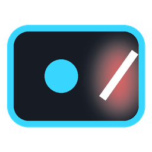
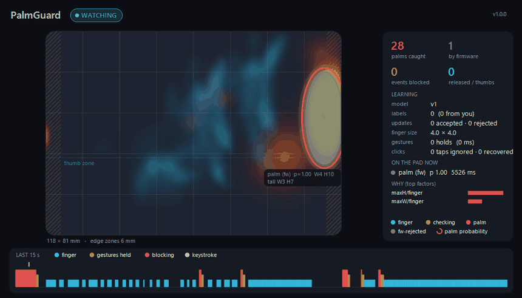
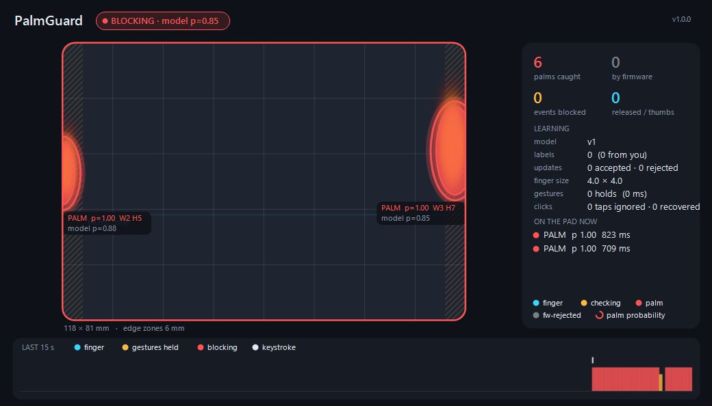
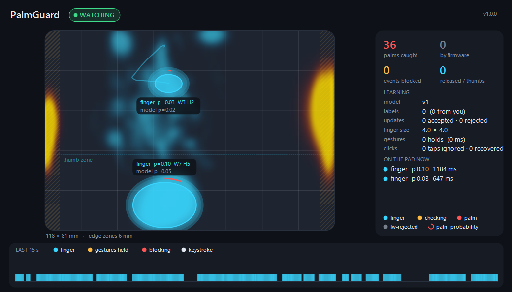
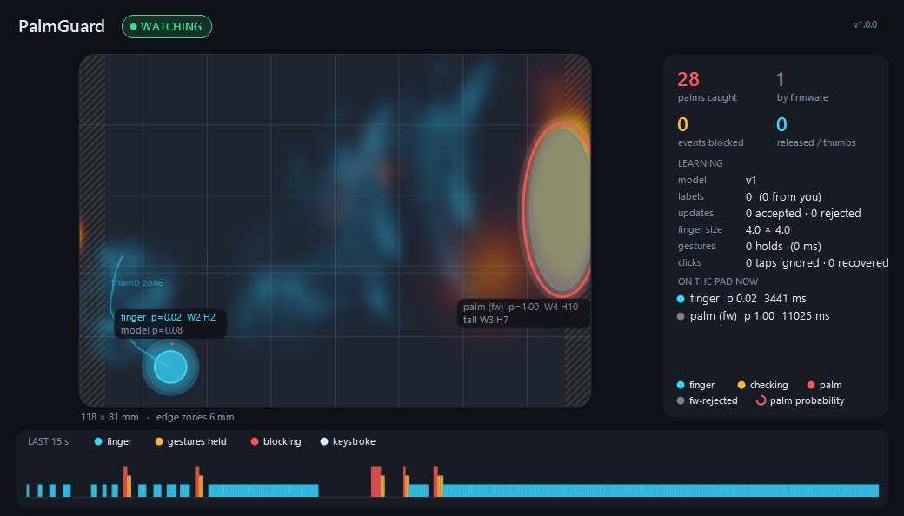
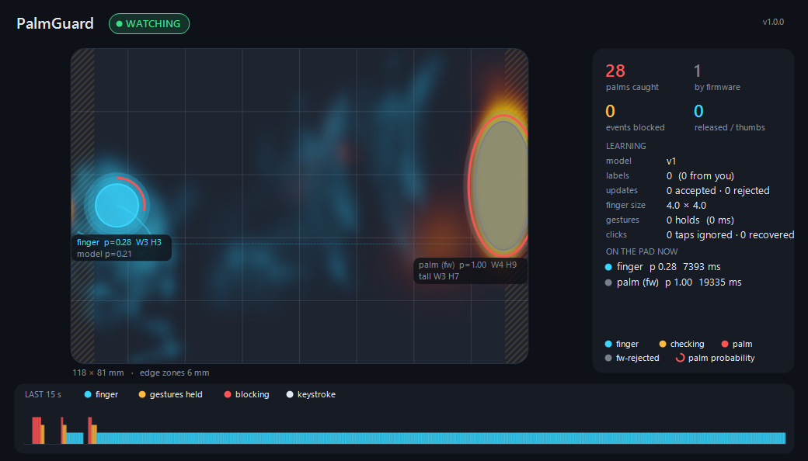
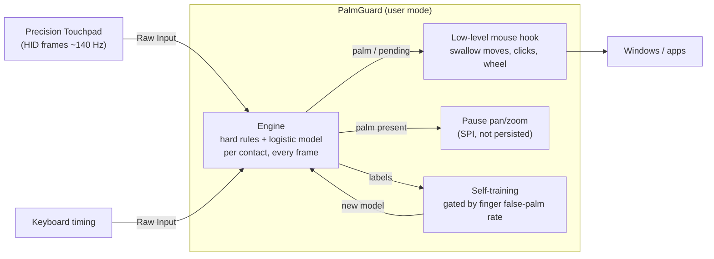
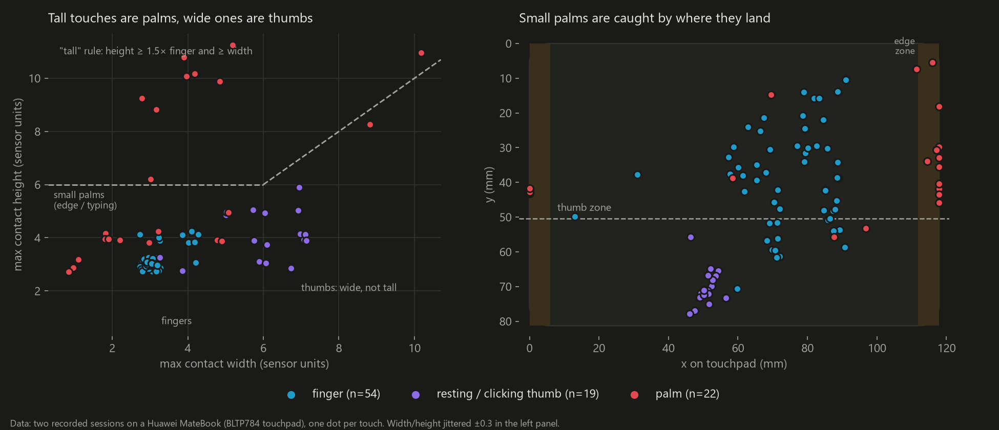

<div align="center">



# PalmGuard

**MacBook-style palm rejection for Windows Precision Touchpads.**
Your palms stop moving the cursor. Your fingers and resting thumb keep working. No driver required.

[](https://github.com/leopck/palmguard/actions/workflows/ci.yml)


[](LICENSE)



<sub>Replay of a real recording: a palm rests on the right edge (red, rejected) while a finger moves the cursor (cyan, allowed).</sub>

</div>

---

## The problem

Many Windows laptops ship large touchpads whose firmware is slow or too lenient at rejecting palms:

- A palm resting on the **edge** is reported as a finger for **0.3–2 seconds** before the firmware changes its mind. The cursor jumps during that time.
- A palm **brushing the pad while you type** is never flagged at all.
- **Two palms** become a pinch, and the page zooms.
- Lowering Windows' "touchpad sensitivity" only affects taps, and makes the pad feel worse.

macOS solves this in software, judging each touch from its shape, its motion and what you're doing. **PalmGuard brings the same approach to Windows.**

## Features

- 🖐 **Probabilistic palm rejection.** A 23-feature model looks at shape, growth, edge distance, motion, typing activity and nearby touches, re-scored on every frame.
- ⚡ **Zero added latency for normal pointing.** A touch is only held (≤ 100 ms) when it's ambiguous: at the edge, right after typing, or next to a palm.
- 👍 **Thumb-aware.** A resting or clicking thumb is wide, not tall, and stays allowed while your index finger points.
- 🤏 **No phantom zoom or scroll.** Scroll and zoom gestures pause while a palm is down, without changing your saved settings.
- 🧭 **Mac-style scrolling (opt-in).** Two-finger scrolling locks to the axis you start on, so a vertical scroll no longer drifts the page sideways. A clear sideways move breaks the lock. Flicks keep gliding with momentum, and a new touch catches the page.
- 👆 **Two-finger press = right click.** Press the pad with two fingers down, even mid-scroll, and you get a right click. A resting thumb doesn't count, so thumb + finger clicks stay left clicks.
- 🖱 **Click repair.** Accidental thumb taps no longer trigger Windows' *tap-and-drag* (which leaves the left button stuck down), and physical presses that Windows drops are recovered.
- 🧠 **Self-learning, safely.** It learns from **Ctrl+Alt+Z** ("a palm got through"), **Ctrl+Alt+X** ("my finger was ignored") and automatic hindsight labels. A new model is only adopted if it doesn't ignore more fingers.
- 📏 **Self-calibrating.** Contact sizes are normalised to *your* finger on *your* touchpad.
- 🔥 **Live dashboard** with a heat map, live touch outlines, palm probability, the factors behind each decision and a 15-second timeline.
- 🛟 **Fails open.** Any error lets input through. Gestures are restored and stuck buttons released on exit or crash. The mouse hook is watched and reinstalled if Windows drops it.
- 📦 **Single 60 KB exe, no installer, no dependencies.** It's built with the C# compiler that already ships with Windows.

## Screenshots

| Two palms resting while typing: both rejected | Resting thumb + pointing finger: both allowed |
|---|---|
|  |  |
| **Palm on the edge, finger pointing** | **Heat map after a typing session** |
|  |  |

Red/yellow heat shows where palms land; cyan shows where fingers work. The ring around each touch is its palm probability.

## How it works



Contact **shape** and **position** carry most of the signal:



- **Palms are tall** (height ≥ 1.5× a finger) and land on the **edges**.
- **Thumbs are wide but short** and live in the bottom third.
- **Small palm brushes** are caught by edge position, typing context, stillness and nearby touches.

The full write-up is in **[docs/ALGORITHM.md](docs/ALGORITHM.md)**: features, decision policy, the self-learning gate, click repair and evaluation. The design draws on:

- Schwarz et al., *Probabilistic Palm Rejection Using Spatiotemporal Touch Features and Iterative Classification*, CHI 2014
- the Chromium OS palm classifier
- libinput's palm detection

## Install

**Download:** grab `PalmGuard-win-x64.zip` from [Releases](https://github.com/leopck/palmguard/releases), unzip it anywhere, and run `PalmGuard.exe`.

> The exe isn't code-signed, so Windows SmartScreen may warn on first run (*More info → Run anyway*). Build from source if you'd rather not trust a binary.

**Build from source** (Windows 10/11, no SDK needed):

```bat
git clone https://github.com/leopck/palmguard
cd palmguard
build.cmd
bin\PalmGuard.exe
```

## Usage

PalmGuard lives in the **system tray**. Left-click the icon for the dashboard; right-click for the menu.

| Shortcut | Action |
|---|---|
| **Ctrl+Alt+P** | Pause / resume (stock touchpad behaviour while paused) |
| **Ctrl+Alt+Z** | "A palm got through" — labels recent finger touches as palms and retrains |
| **Ctrl+Alt+X** | "My finger was ignored" — labels recently blocked touches as fingers and retrains |

Tray menu → **Start with Windows** adds a per-user autostart entry (`--tray` starts hidden). Closing the dashboard hides it; **Exit** quits. From a script: `PalmGuard.exe --exit` asks a running instance to shut down cleanly.

Settings live in `%LOCALAPPDATA%\PalmGuard\settings.ini`. All of them can be toggled from the tray menu:

| Setting | Default | Meaning |
|---|---|---|
| `Enabled` | 1 | palm rejection on/off |
| `Learning` | 1 | learn from corrections and hindsight labels |
| `ThumbTapIgnore` | 1 | ignore brief taps in the thumb zone (prevents stuck tap-and-drag) |
| `ClickRecovery` | 1 | re-send physical clicks that Windows dropped |
| `GestureHold` | 1 | pause scroll/zoom while a palm is down |
| `RecordSessions` | 1 | keep local recordings for tuning/replay |
| `MacScroll` | 0 | PalmGuard does two-finger scrolling itself (axis lock + momentum); Windows' own pan gesture is switched off while it runs |
| `Momentum` | 1 | keep scrolling after a flick (with `MacScroll`) |
| `ScrollSpeed` | 100 | scroll speed in percent (with `MacScroll`) |
| `ScrollReverse` | 0 | flip the direction relative to Windows' "scrolling direction" setting |
| `TwoFingerClick` | 1 | physical press with two fingers down = right click |
| `MaxSessions` / `MaxSessionMB` | 20 / 300 | recording retention |

## Results

These numbers are from replaying recorded sessions through the shipping engine (`bin\Replay.exe`). GitHub CI re-runs them on every push.

| | |
|---|---|
| Palm touches that moved the cursor (22 palms) | **0** |
| Finger cursor movement lost | **0.0 %** of 50,498 px |
| Finger decision latency | median **0 ms**, p90 0 ms |
| Resting/clicking thumbs held back (19 thumbs) | 1, for ~20 ms |
| 5-fold cross-validation (per touch) | palm recall **95.4 %**, finger false-palm **0.6 %** |

## Is it production ready?

**The software is.** It's a polished tray app with a dedicated input thread and fail-open hooks. It has a watchdog, handles sleep and device changes, runs as a single instance, cleans up after crashes, has settings and log retention, and CI runs regression tests on every push.

**The accuracy claims are not universal yet.** Be aware that:

- The seed model was trained on **one laptop** (Huawei MateBook, `BLTP784` touchpad) and **one person's hands**.
- On other touchpads it starts in a cautious **uncalibrated** mode, with size rules off: 19/22 palms caught in replay. It calibrates after about 8 deliberate finger strokes.
- Touchpads that don't report contact **width/height** (optional in the PTP spec) get reduced accuracy.
- It's a user-mode app. Very occasionally the first ~7 ms frame of a palm can reach Windows before the decision. A kernel filter driver that clears the PTP confidence bit would remove that and is the logical next step.
- Physical click force/hysteresis is hardware. On the reference touchpad, a resting thumb can keep the mechanical button held, and no software can change that.

**Recordings from other laptops are the most valuable contribution.** See below.

## Contributing data and tools

All tools are in `tools/` and build with `build.cmd`:

| Tool | What it does |
|---|---|
| `Replay.exe` | Replays recorded sessions through the engine; `--assert` regression gates, `--cv` cross-validation, `--train` retrains the seed model |
| `PalmGuard.exe --replay <dir>` | Plays a session through the real dashboard (used for the screenshots and GIF) |
| `TouchLogger.exe` | Guided 75-second scripted recording (fingers, typing with palms, scrolling, resting palm, palm + finger) |
| `ForceProbe.exe` | Read-only probe for vendor HID channels (looks for force data) |
| `HidCaps.exe`, `TouchpadParams.exe` | Dump the touchpad's HID capabilities / Windows touchpad parameters |

To contribute a dataset, run `TouchLogger.exe <folder>` and open a PR with `touch.csv` + `keys.csv`, plus your laptop model. Key logs contain **timestamps only**; recorded datasets never include which keys you pressed.

## Privacy

Everything stays on your machine. PalmGuard makes no network connections. Session recordings in `%LOCALAPPDATA%\PalmGuard\sessions` contain touch coordinates and keystroke *timestamps* (never key codes). They're capped by `MaxSessions`/`MaxSessionMB` and can be disabled with `RecordSessions=0`.

## Uninstall

Untick **Start with Windows**, exit from the tray, delete the folder, and optionally delete `%LOCALAPPDATA%\PalmGuard`. Nothing else is installed.

## License

[MIT](LICENSE)
