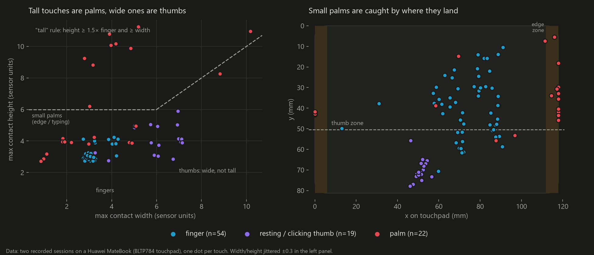

# How PalmGuard decides what is a palm

This document describes the classifier in [`src/Engine.cs`](../src/Engine.cs) and the input plumbing in [`src/PalmGuard.cs`](../src/PalmGuard.cs).

## 1. What the touchpad gives us

A Windows Precision Touchpad (PTP) reports up to 5 contacts per frame at about 140 Hz. For each contact:

| Field | HID usage | Notes |
|---|---|---|
| contact id, tip switch | `0x0D/0x51`, `0x0D/0x42` | contact lifetime |
| X, Y | `0x01/0x30`, `0x01/0x31` | converted to **millimetres** using the descriptor's physical extent |
| width, height | `0x0D/0x48`, `0x0D/0x49` | optional in the PTP spec; **vendor-specific units** |
| confidence | `0x0D/0x47` | the firmware's own "this is a finger" verdict; Windows ignores contacts with confidence = 0 |
| button | `0x09/0x01` | physical click |

PalmGuard reads these through Raw Input (`RIDEV_INPUTSINK`), so it sees every frame no matter which app has focus.

## 2. Why palms get through

On the reference laptop (Huawei MateBook, `BLTP784` touchpad), two recordings showed:

* **Edge palms** land hanging off the left or right edge and are **tall** (height 6–11 units, width 2–4). The firmware does flag them eventually, but only **0.3–2.1 s** after touchdown. The cursor jumps during that delay.
* **Brushes while typing** land mid-pad and are **wide** (width 4–5). The firmware never flags them. They caused the largest jumps (up to ~490 px).
* **Resting or clicking thumbs** in the bottom third are **wide but short** (width 5–7, height 3–5) and always firmware-confident. They must *not* be treated as palms.



## 3. Classification pipeline

Each contact moves through `Pending → Finger | Palm`. Re-evaluation happens on **every frame**: classification is iterative, as in Schwarz et al., but continuous rather than on fixed checkpoints.

### 3.1 Hard guard rails (always win)

| Rule | Condition | Source |
|---|---|---|
| Firmware palm | confidence = 0 at any frame | libinput (trust firmware) |
| Tall contact | `maxH ≥ 1.5 × fingerH` **and** `maxH ≥ maxW` | data (palms are tall) |
| Huge contact | `maxW × maxH ≥ 3.5 × fingerW × fingerH` | data |
| Wide while typing | `maxW ≥ 1.25 × fingerW`, touch started < 1 s after a keystroke, outside the thumb zone | data and libinput disable-while-typing |
| **Release** | net travel ≥ 8 mm with straightness ≥ 0.8 | Chromium OS "fat finger" release |
| **Thumb click** | physical click while a thumb-zone contact is blocking and there has been no typing for 0.5 s | data (thumb clicks) |

Once a contact is a palm it stays a palm (libinput), except through the release rule.

### 3.2 Probabilistic model

A logistic regression over 23 features, all computed from the contact's history since touchdown:

| # | Feature | Intuition |
|---|---|---|
| 1–3 | max height, max width, mean area, each divided by calibrated finger size | palms are big |
| 4–5 | size jitter, size growth since touchdown | palms deform and grow (Schwarz et al.) |
| 6–8 | `exp(-d/6mm)` to side, bottom and top edges | palms land at edges (libinput, Chromium) |
| 9–11 | net travel, straightness, speed | fingers travel with purpose |
| 12–13 | keystroke recency (`exp(-Δt/0.5s)`), typing burst size | disable-while-typing |
| 14–15 | distance to other touches, palms already present | split palms cluster together |
| 16–17 | typing × width, typing × edge | interaction terms |
| 18–20 | age, stillness, stillness × edge | Chromium stationary-palm rule |
| 21–23 | thumb zone, thumb zone × width, tallness `(H−W)/fingerH` | tells thumbs apart from palms |

The decision policy keeps latency low for normal finger use:

```
p ≤ 0.25            -> Finger immediately (zero-latency for ordinary pointing)
p ≥ 0.60            -> Palm immediately
otherwise           -> Pending (input held) until 100 ms, then Palm iff p ≥ 0.5
Finger, later p ≥ 0.85 (before 500 ms) -> revised to Palm
after 500 ms        -> only hard rules can change the class
```

While **any contact Windows still trusts** (confidence = 1) is `Pending` or `Palm`, PalmGuard:

* swallows touchpad mouse moves, clicks and wheel events (`WH_MOUSE_LL`)
* turns Windows pan/zoom gestures off through the non-persistent `SPI_SETTOUCHPADPARAMETERS`. Gestures are delivered through DirectManipulation, which bypasses mouse hooks.

## 4. Self-calibration

Width/height units differ by vendor. PalmGuard keeps the median max size of the last 64 *deliberate* finger strokes: at least 20 mm of travel, no typing within 1 s, not clicked. It sets `fingerW/H = 4 × median / 3`, so a typical finger maps to about 0.75 on every device. Until 8 such strokes have been seen on a new device, size rules are disabled and size features are neutral.

## 5. Self-learning

Labels come from five sources:

| Source | Weight | Label |
|---|---|---|
| You press **Ctrl+Alt+Z** ("palm got through") | 1.0 | recent finger contacts → palm |
| You press **Ctrl+Alt+X** ("finger was ignored") | 1.0 | recently blocked contacts → finger |
| Firmware flagged the contact late | 0.5 | early checkpoints → palm |
| Contact grew past a hard size rule later | 0.4 | early checkpoints → palm (learn to recognise it sooner) |
| Thumb click on a doubted contact | 0.5 | → finger |
| Long deliberate stroke, no typing nearby | 0.3 | → finger |

The labels feed a class-balanced logistic regression trained with Adam and L2-regularised **toward the seed model**, not toward zero. Retraining runs in the background after every 40 new labels or after any correction. A new model is **only accepted if it does not raise the false-palm rate on fingers** on the validation set, which is the seed data plus all of your corrections. A bad batch of weak labels can't quietly break thumbs or fingers.

## 6. Click repair

* **Thumb-zone taps are ignored.** A resting thumb that lifts for about 30 ms looks like a tap to Windows. Windows' "tap twice and drag" then holds the left button down until the thumb lifts, and swallows every physical press in between.
* **Recovery.** If the touchpad reports a physical press and Windows delivers no button-down within 60 ms, PalmGuard injects one, then releases it when the touchpad does.

## 7. Evaluation

`bin\Replay.exe` replays recorded sessions through the exact same engine.

| Metric (reference device) | Value |
|---|---|
| Palm contacts that leaked (scripted session, 22 palms) | **0** |
| Finger cursor movement lost | **0.0 %** of 50,498 px |
| Finger decision latency | median **0 ms**, p90 0 ms, max 14 ms |
| Thumb clicks held back (19 thumbs) | 1, for 3 frames |
| 5-fold CV by contact, checkpoint level | palm recall **95.4 %**, finger false-palm **0.6 %** |
| New device, before calibration (size rules off) | 19 / 22 palms caught |

These numbers come from one laptop and one person's hands, about 3 minutes of labelled data. Treat them as a regression baseline, not a general accuracy claim.

## 8. References

* J. Schwarz, R. Xiao, J. Mankoff, S. Hudson, C. Harrison. *Probabilistic Palm Rejection Using Spatiotemporal Touch Features and Iterative Classification.* CHI 2014. <https://www.robertxiao.ca/research/palm-rejection/>
* Chromium OS gestures, `palm_classifying_filter_interpreter.cc`. <https://chromium.googlesource.com/chromiumos/platform/gestures/>
* libinput palm detection. <https://wayland.freedesktop.org/libinput/doc/latest/palm-detection.html>
* Microsoft, *Windows Precision Touchpad Required HID Top-Level Collections*.
